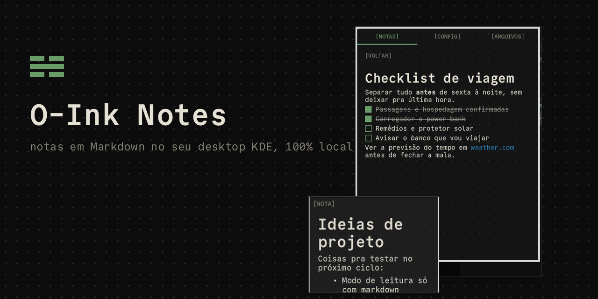
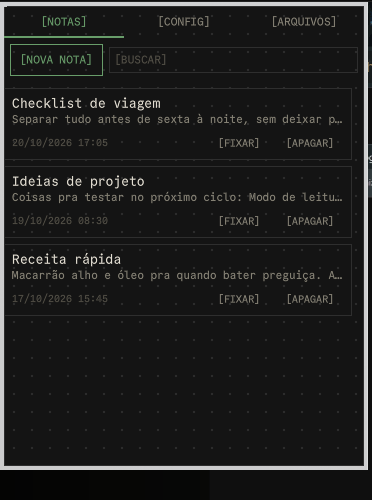
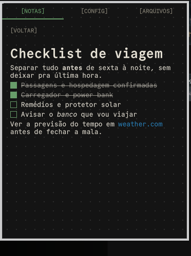
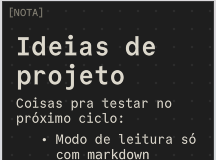

# O-Ink Notes



Um mini app de notas em Markdown pro KDE Plasma 6, feito pra combinar com o
meu tema [O-Ink](https://github.com/ownaka/obsidian-o-ink): fundo escuro,
cantos retos, fonte Commit Mono, rótulos entre colchetes (`[NOTA]`,
`[CONFIG]`...) e um verde discreto como destaque.

## Por quê

Eu queria anotar coisas rápidas no desktop sem abrir um app pesado, sem
conta, sem sincronização na nuvem e sem nada que não combinasse com a cara
do meu Plasma. Não encontrei nada assim, então fiz.

## 100% local, 100% gratuito

- **Sem conta.** Não existe login, nem cadastro.
- **Sem nuvem.** Suas notas nunca saem da sua máquina.
- **Sem anúncios.** Nenhum.
- **Sem coleta de dados.** Nada é enviado pra lugar nenhum — o app não
  tem rede.
- **Código aberto, de graça**, licença MIT. Veja [LICENSE](LICENSE).

## O que é

Dois plasmoides:

- **`net.ownaka.oinknotes`** — o controlador. Fica como ícone no painel
  (ou na bandeja do sistema, se você habilitar em "Configurar Bandeja do
  Sistema → Entradas → O-Ink Notes"). Clicando nele abre um popup com
  tudo: lista de notas com busca, editor, configurações e
  importar/exportar. Não existe nenhuma janela separada.
- **`net.ownaka.oinknote`** — uma nota fixada na área de trabalho. Você
  não instala isso manualmente: o botão "[FIXAR]" do popup cria uma
  instância dele pra você, já apontando pra nota certa.

## Funcionalidades

- Notas em Markdown (títulos, negrito, itálico, código, links, listas),
  com listas de tarefas (`- [ ]`) clicáveis.
- Clique pra editar, clique fora pra voltar a renderizar.
- Lista de notas em cards: título, prévia do conteúdo, data da última
  edição, busca por título/conteúdo, mais recentes primeiro.
- Fixar/desafixar qualquer nota na área de trabalho, com indicador verde
  mostrando quais já estão fixadas.
- Apagar nota com confirmação.
- Importar/exportar `.md` de uma pasta configurável (padrão
  `~/Documentos/O-Ink Notes`).
- Visual configurável: cor de destaque, tamanho de fonte, opacidade da
  nota, mostrar/esconder os pontinhos de fundo, pasta de armazenamento.

## Requisitos

- KDE Plasma 6.

## Instalar

```sh
./instalar.sh
```

Isso copia o código compartilhado pros dois pacotes e instala (ou
atualiza, se já estiver instalado) os dois plasmoides via
`kpackagetool6`. Depois, adicione o "O-Ink Notes" num painel (clique
direito no painel → Adicionar Widgets).

Se mexer no código, rode `./instalar.sh` de novo pra atualizar, e talvez
precise reiniciar o Plasma pra ver as mudanças:

```sh
systemctl --user restart plasma-plasmashell
```

## Desinstalar

```sh
./desinstalar.sh
```

Remove os dois plasmoides. Suas notas e configurações **não** são
apagadas.

## Onde ficam seus dados (e como fazer backup)

- Notas: `~/.local/share/o-ink-notes/notes/<id>.md` — um arquivo por
  nota, com um cabeçalho simples (`title`, `created`, `modified`) e o
  corpo em Markdown puro.
- Configurações visuais (cor de destaque, tamanho de fonte, opacidade,
  pontinhos de fundo, pastas): `~/.config/o-ink-notes/settings.json`,
  compartilhado entre o popup e todas as notas fixadas.
- Pasta de importar/exportar: configurável no popup, padrão
  `~/Documentos/O-Ink Notes`.

Pra fazer backup, basta copiar essas duas pastas:

```sh
cp -r ~/.local/share/o-ink-notes ~/.config/o-ink-notes /caminho/do/backup
```

Como são arquivos `.md` simples, também dá pra versionar com git ou
sincronizar com qualquer ferramenta que você já use (Syncthing, etc.) —
o app não interfere em nada disso.

## Testar sem instalar de verdade

Durante o desenvolvimento, dá pra rodar qualquer um dos dois pacotes
numa janela solta, sem mexer no painel ou na área de trabalho reais:

```sh
./instalar.sh   # garante que o código compartilhado foi copiado
plasmoidviewer -a net.ownaka.oinknotes
plasmoidviewer -a net.ownaka.oinknote
```

## Capturas de tela

| Lista de notas | Nota aberta | Nota fixada na área de trabalho |
| --- | --- | --- |
|  |  |  |

## Estrutura do projeto

```
shared-qml/                  código comum (copiado pros 2 pacotes na instalação)
net.ownaka.oinknotes/        controlador (ícone + popup)
net.ownaka.oinknote/         widget de nota (área de trabalho)
instalar.sh / desinstalar.sh
scripts/generate_cover.py    gera assets/cover.png
```

## Limitações conhecidas (v1)

- Lista de tarefas (`- [ ]`) é renderizada à mão (o `Text.MarkdownText`
  do Qt não faz checkbox clicável); o resto do Markdown (títulos,
  negrito, itálico, código, links, listas comuns) usa o suporte nativo
  do Qt 6.
- "Fixar na área de trabalho" sempre usa o primeiro monitor/área de
  trabalho (`desktops()[0]`); não escolhe tela em setups multi-monitor.

## Créditos

- Fonte [Commit Mono](https://commitmono.com/), licença SIL Open Font
  License.
- Tema visual [O-Ink](https://github.com/ownaka/obsidian-o-ink), que eu
  também fiz.
- Mais sobre mim: [ownaka.net](https://ownaka.net).
- Feito com ajuda do [Claude Code](https://claude.com/claude-code).

## Licença

MIT. Veja [LICENSE](LICENSE).

---

## English summary

O-Ink Notes is a small Markdown notes app for KDE Plasma 6, styled after
my [O-Ink theme](https://github.com/ownaka/obsidian-o-ink) (dark
background, square corners, Commit Mono font, green accent). It ships as
two plasmoids: a panel/tray controller with a popup for listing,
searching, editing, pinning and importing/exporting notes, and a desktop
widget that shows one pinned note at a time. Notes are plain Markdown
files with simple frontmatter, stored at
`~/.local/share/o-ink-notes/notes/`; shared settings live at
`~/.config/o-ink-notes/settings.json`. It's 100% local, 100% free, no
account, no cloud, no ads, no data collection — MIT licensed. Install
with `./instalar.sh`, uninstall with `./desinstalar.sh`. Requires KDE
Plasma 6.
